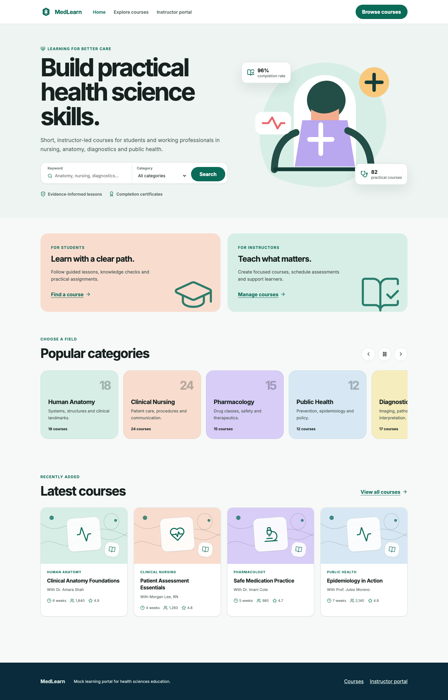
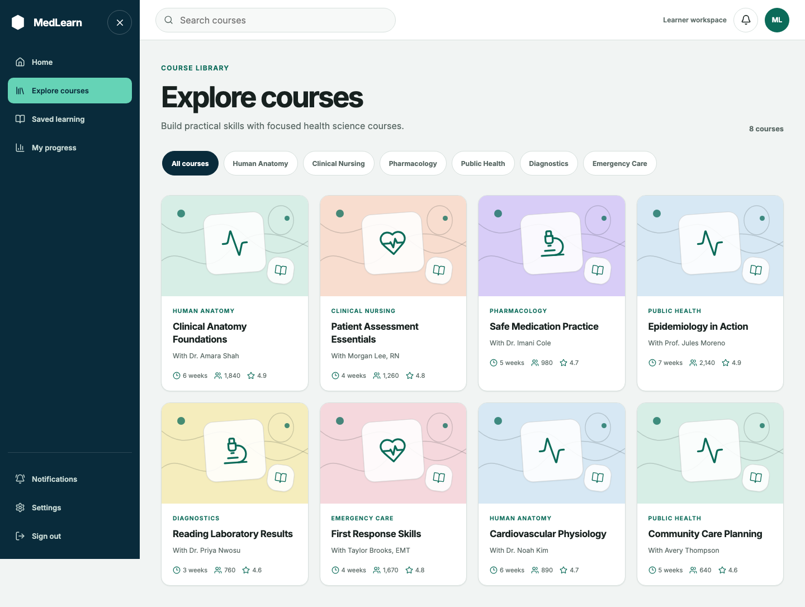
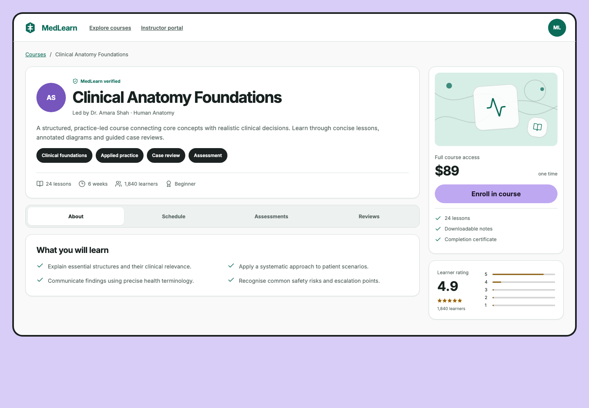
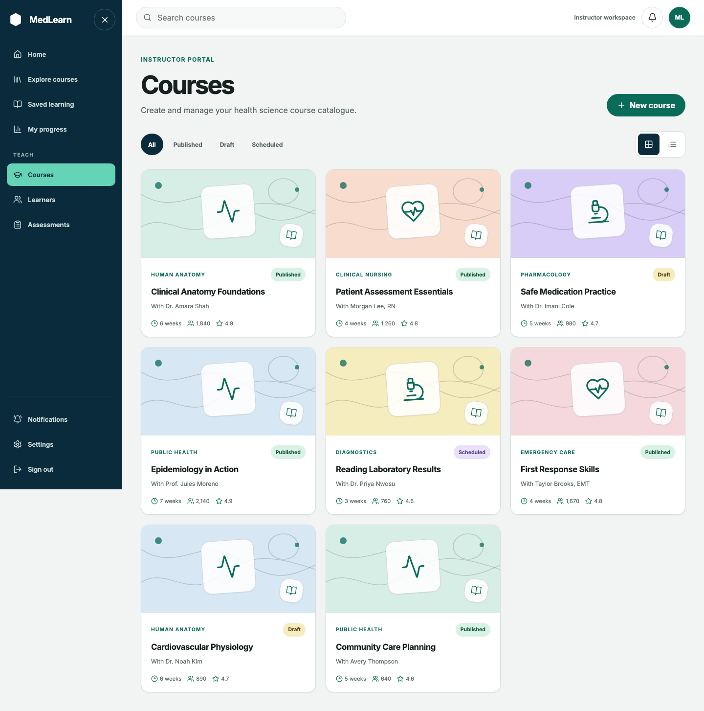

# MedLearn

MedLearn is a responsive mini course portal for health-science education. It is built with Vue 3 Composition API, strict TypeScript, Vue Router, and Vite. All people, courses, ratings, prices, and activity shown in the interface are mock data.

## Screens

| Home | Explore courses |
| --- | --- |
|  |  |

| Course detail | Manage courses |
| --- | --- |
|  |  |

Mobile captures are also available in [`docs/screenshots`](docs/screenshots).

## Setup

Requirements: Node.js 20 or newer and npm.

```bash
npm install
npm run dev
```

The development server prints its local URL. Routes:

- `/` — public landing page
- `/courses` — course catalogue
- `/courses/clinical-anatomy-in-practice` — course detail
- `/manage` — instructor course management

## Testing

```bash
npm run test       # Vitest component and axe-core checks
npm run build      # strict TypeScript and production build
npm run test:e2e   # Playwright keyboard flows
npm run check      # all of the above
```

Install the Playwright browser once if needed:

```bash
npx playwright install chromium
```

The Vitest accessibility suite runs axe-core against every screen. Since jsdom has no layout engine, its colour-contrast rule is disabled there; the colour pairs are centralized in `src/styles/base.css` for manual/browser contrast review. Playwright covers the interactions that static analysis cannot verify.

## Components and accessibility coverage

| Component | Purpose | WCAG 2.2 support |
| --- | --- | --- |
| `SkipLink` | Moves keyboard focus past repeated navigation | 2.4.1 Bypass Blocks |
| `PublicHeader`, `AppSidebar`, `WorkspaceHeader` | Semantic navigation and responsive workspace shell | 1.3.1 Info and Relationships; 2.4.3 Focus Order; 2.4.6 Headings and Labels; 2.5.8 Target Size |
| `SearchCombobox` | Keyword suggestions plus category search | 1.3.1; 2.1.1 Keyboard; 3.3.2 Labels or Instructions; 4.1.2 Name, Role, Value |
| `CategoryCarousel` | Manually controlled, horizontally scrollable topics | 2.1.1 Keyboard; 2.2.2 Pause, Stop, Hide; 2.5.7 Dragging Movements; 4.1.2 |
| `CourseCard`, `CourseArtwork` | Course summary with original vector artwork | 1.1.1 Non-text Content; 1.4.1 Use of Colour; 1.4.3 Contrast |
| Course information tabs | Roving focus tabs with associated panels | 2.1.1; 2.4.3; 2.4.7 Focus Visible; 4.1.2 |
| Schedule picker | Native radio-group time selection | 1.3.1; 2.1.1; 3.3.2; 4.1.2 |
| `BaseModal` | Labelled dialog, focus trap, Escape dismissal, focus return | 2.1.1; 2.1.2 No Keyboard Trap; 2.4.3; 2.4.11 Focus Not Obscured; 4.1.2 |
| New-course form | Linked summary and persistent inline validation | 3.3.1 Error Identification; 3.3.2; 3.3.3 Error Suggestion; 4.1.3 Status Messages |
| Success toast | Non-blocking creation confirmation | 4.1.3 Status Messages |

Across the app, semantic landmarks and one `h1` per page support 1.3.1 and 2.4.6. Shared focus styles support 2.4.7, controls are at least 44×44 CSS pixels, layouts reflow at 320px and 200% zoom, status text does not rely on colour alone, and motion is reduced under `prefers-reduced-motion`.

## Keyboard operation

- `Tab` / `Shift+Tab`: move through interactive controls.
- Home search: `ArrowDown` and `ArrowUp` move through suggestions; `Enter` selects; `Escape` closes the list.
- Course tabs: `ArrowLeft` and `ArrowRight` change tabs; `Home` selects the first tab; `End` selects the last.
- Schedule: arrow keys move among time-slot radio buttons; `Space` selects.
- Dialogs: `Tab` and `Shift+Tab` remain within the dialog; `Escape` closes it and returns focus to the opener.
- Error summary: activate an error link to move directly to the invalid field.

## Screen-reader testing

### NVDA with Firefox or Chrome

1. Start the app and NVDA.
2. Press `Insert+F7` to inspect landmarks, headings, links, and form controls.
3. Move through each page with `H`, `D`, and `Tab`; confirm the single page heading and current navigation state are announced.
4. In the home combobox, use arrow keys and confirm the expanded state and active suggestion are announced.
5. Open each modal, verify its title/description are announced, then close it with `Escape` and confirm focus returns.
6. Submit the empty new-course form and confirm the error summary is announced before following each linked error.

### VoiceOver on macOS with Safari

1. Enable VoiceOver with `Command+F5`.
2. Use `Control+Option+U` to inspect landmarks and headings.
3. Navigate controls with `Control+Option+Right Arrow`; use `Control+Option+Space` to activate them.
4. Turn Quick Nav off while testing the combobox and tabs so their arrow-key interactions are passed to the page.
5. Repeat the modal and error-summary checks above, including focus return.

## Architecture

- `src/data/mock.ts` keeps mock catalogue data separate from presentation.
- `src/types.ts` defines the shared strict TypeScript models.
- `src/components` contains reusable navigation, artwork, card, combobox, carousel, and modal components.
- `src/views` contains the four route-level screens.
- `src/styles/base.css` contains the shared Inter-based design tokens and responsive system.
- `tests` contains Vitest and axe-core coverage; `e2e` contains Playwright keyboard scenarios.

## Limitations

- This is a frontend-only demonstration: enrollment and course creation are held only in local component state and are not persisted.
- Search results, notifications, prices, reviews, and learner counts are illustrative mock data.
- The custom artwork is decorative SVG/CSS illustration, not clinical imagery or medical guidance.
- Automated testing supports, but does not replace, testing with disabled users and real assistive technology.
